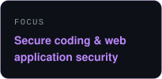
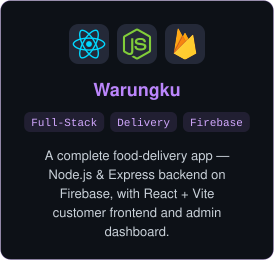
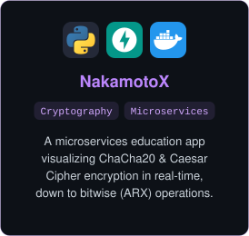
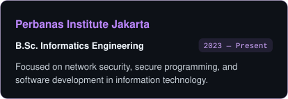
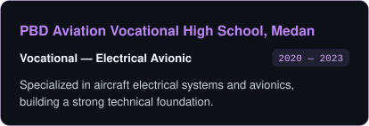

<!-- ===== ANIMATED TERMINAL BANNER ===== -->

  

<!-- ===== SOCIAL BADGES ===== -->

  
  
  
  
  

<!-- ===== ABOUT ===== -->
## About Me

I'm a **7th-semester Informatics Engineering student** at **Perbanas Institute Jakarta** focused on **building secure web applications**. That goal is what drew me to **cyber security**: I study how systems break so I can build ones that don't. I treat security as the foundation of an application, not a feature added at the end.

  
  
  
  

<!-- ===== PROJECTS ===== -->
## Featured Projects

  
  
  

<!-- ===== SKILLS ===== -->
## Tech Arsenal

  

<!-- ===== EDUCATION ===== -->
## Education

  
  

<!-- ===== STATS ===== -->
## GitHub Stats

  
  

  

<!-- ===== SNAKE ANIMATION ===== -->

  

<!-- ===== FOOTER ===== -->

  

