<!-- ===== ANIMATED TERMINAL BANNER ===== -->

  

<!-- ===== SOCIAL LINKS ===== -->

  
  
  
  
  

<!-- ===== ABOUT ===== -->
## About Me

  

<!-- ===== PROJECTS ===== -->
## Featured Projects

  
  
  

<!-- ===== SKILLS ===== -->
## Tech Arsenal

  

<!-- ===== EDUCATION ===== -->
## Education

  

<!-- ===== STATS ===== -->
## GitHub Stats

  
  

<!-- ===== SNAKE ANIMATION ===== -->

  

